# MessManager – Mess Management App

An Android application that digitizes daily meal tracking, shared expense management and monthly financial settlement for bachelor messes, hostels and other shared living arrangements.

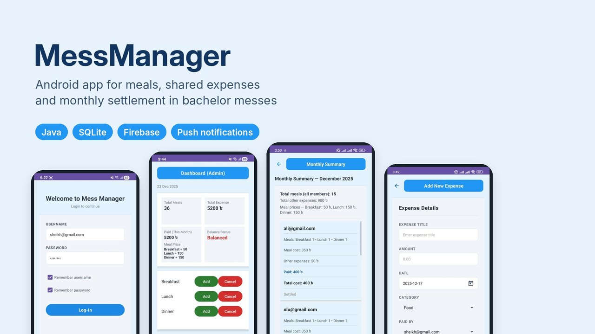

**Download:** [MessManager.apk](https://github.com/ssheikhs/MessManager-Mess-Management-App/raw/master/MessManager.apk) (Android 7.0 or later)

---

## Overview

In bachelor messes, daily meals and shared costs are usually tracked by hand, which leads to calculation errors, missing records and disputes between members. MessManager gives every mess a single, role-based Android app: members record their meals, expenses and payments, and the admin controls meal prices, approves members and settles accounts at the end of the month. Every figure is calculated automatically and visible to everyone.

---

## Screenshots

### Getting started

<table>
  <tr>
    <td align="center">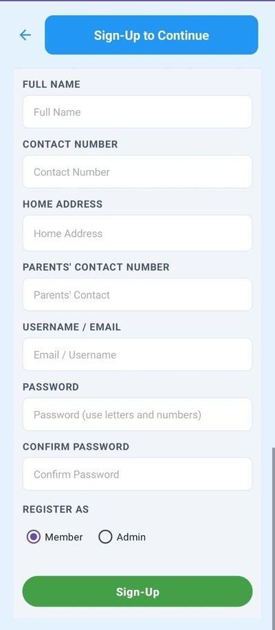<br><sub>Sign up with a role</sub></td>
    <td align="center">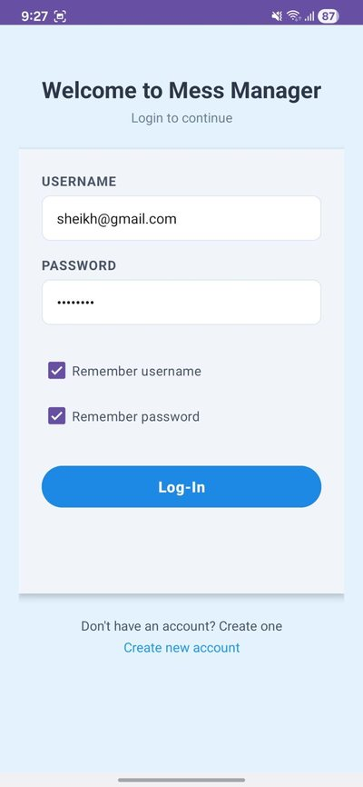<br><sub>Login</sub></td>
    <td align="center">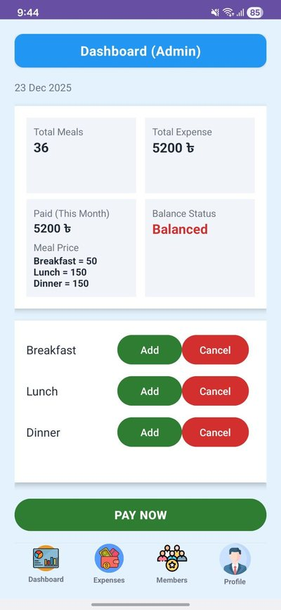<br><sub>Dashboard with daily meal entry</sub></td>
  </tr>
</table>

### Admin tools

<table>
  <tr>
    <td align="center">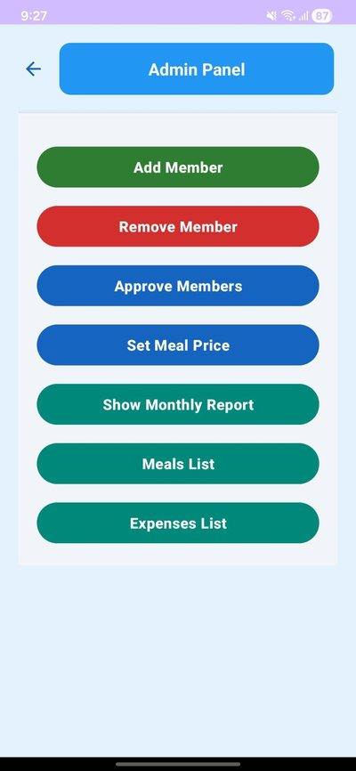<br><sub>Admin panel</sub></td>
    <td align="center">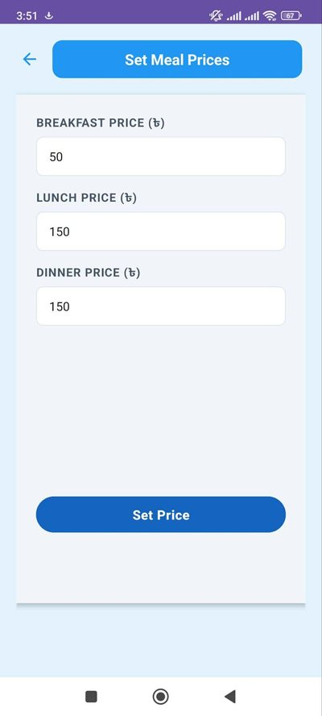<br><sub>Set meal prices</sub></td>
    <td align="center">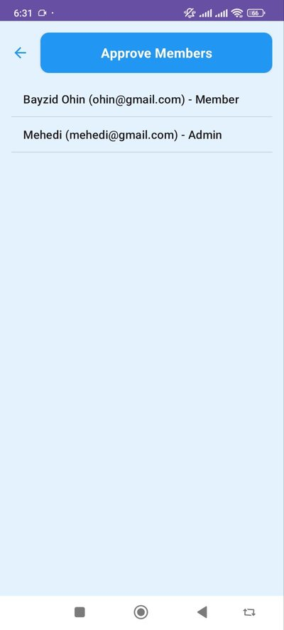<br><sub>Approve new members</sub></td>
  </tr>
  <tr>
    <td align="center">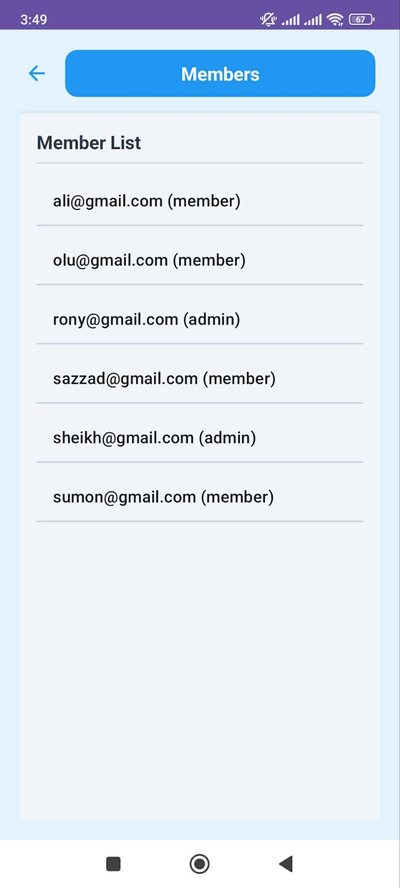<br><sub>Member list</sub></td>
    <td align="center">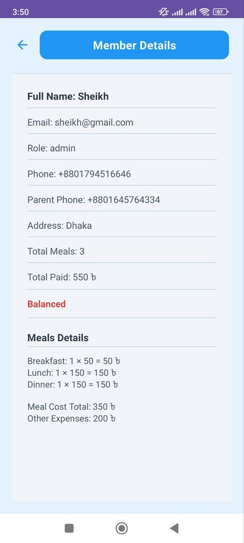<br><sub>Member details and balance</sub></td>
    <td align="center">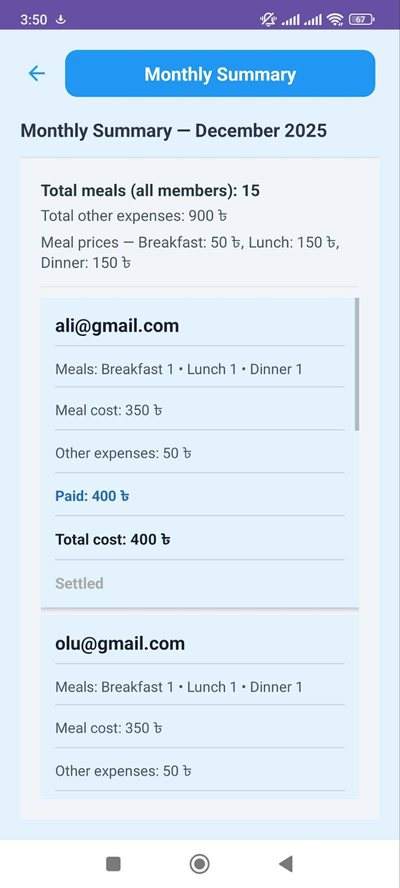<br><sub>Monthly settlement summary</sub></td>
  </tr>
</table>

### Expenses, profile and sync

<table>
  <tr>
    <td align="center">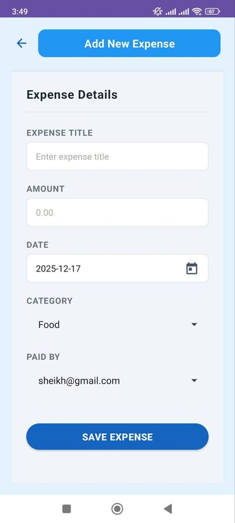<br><sub>Add a shared expense</sub></td>
    <td align="center">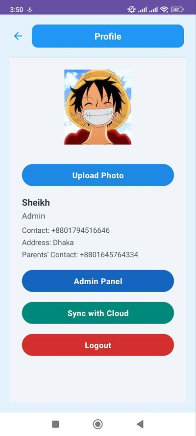<br><sub>Profile, photo upload and cloud sync</sub></td>
  </tr>
</table>

### Notifications

<table>
  <tr>
    <td align="center">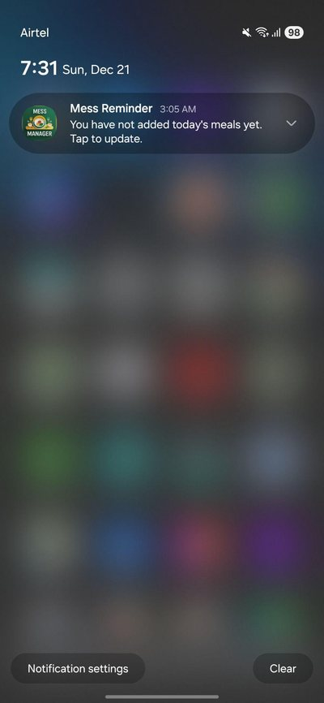<br><sub>Meal reminder</sub></td>
    <td align="center">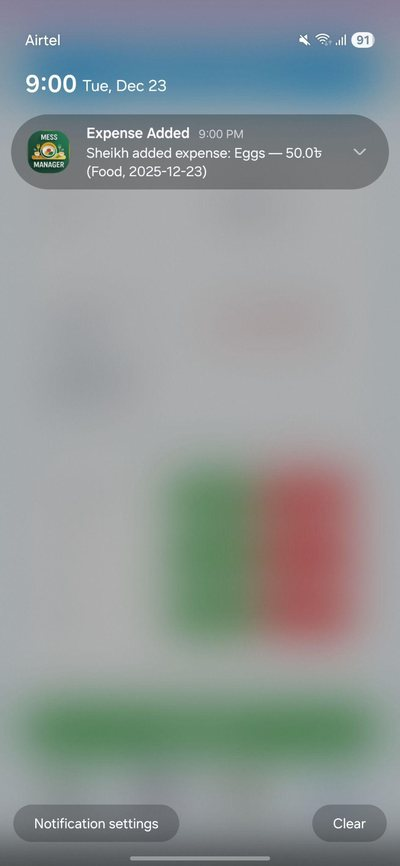<br><sub>Expense added</sub></td>
    <td align="center">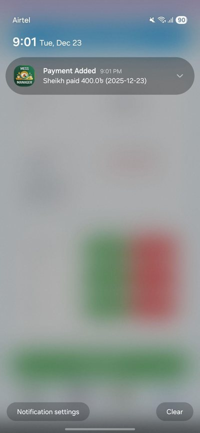<br><sub>Payment confirmation</sub></td>
  </tr>
</table>

---

## Features

### Admin
- **Member management** – approve new registrations, add or remove members and view each member's meals, payments and balance.
- **Meal pricing** – set the price of breakfast, lunch and dinner for the whole mess.
- **Expense management** – log shared expenses by category and see who paid.
- **Live overview** – follow meals and expenses as members record them.
- **Monthly summary** – total meals, meal cost, other expenses, paid amount and settlement status for every member.

### Members
- **Daily meal entry** – add or cancel breakfast, lunch and dinner each day.
- **Expenses and payments** – record shared expenses and payments.
- **Real-time balance** – see total meals, total expense, amount paid and balance status at any time.
- **Profile** – view personal details and upload a profile photo.

### System
- **Role-based access** – admin and member permissions are kept separate.
- **Offline-first storage** – every entry is saved to SQLite first, so the app works without internet.
- **Background cloud sync** – WorkManager syncs local data to Cloud Firestore when the device is online, with a manual "Sync with Cloud" option.
- **Push notifications** – Cloud Functions send alerts to all members when an expense or payment is added, and daily reminders are sent for missing meal entries.
- **Automatic calculations** – meal cost, other expenses, dues and balance are calculated for each member.

---

## Tech stack

| Layer | Technology |
|-------|-----------|
| Language | Java |
| IDE | Android Studio |
| UI | XML layouts, Activities and Intents |
| Local database | SQLite |
| Cloud database | Cloud Firestore |
| File storage | Firebase Storage (profile photos) |
| Authentication | Firebase Authentication |
| Notifications | Firebase Cloud Messaging and Cloud Functions |
| Background work | WorkManager |
| Minimum Android version | Android 7.0 (API 24) |

---

## How it works

1. **Sign up and login** – users register as Admin or Member; members wait for admin approval.
2. **Role-based dashboard** – each user is taken to the screens their role allows.
3. **Offline-first entry** – meals, expenses and payments are saved to SQLite immediately.
4. **Cloud sync** – WorkManager uploads pending records to Firestore whenever the device is online.
5. **Notifications** – Cloud Functions watch Firestore and notify all members of new expenses and payments.
6. **Settlement** – the calculation engine produces the monthly summary used to settle accounts.

---

## Getting started

### Install the app
Download [MessManager.apk](https://github.com/ssheikhs/MessManager-Mess-Management-App/raw/master/MessManager.apk) on an Android phone and open it. You may need to allow installs from unknown sources.

### Build from source

**Prerequisites**
- Android Studio (latest stable version)
- An Android device or emulator running Android 7.0 (API 24) or later
- A Firebase project with Authentication, Cloud Firestore, Storage and Cloud Messaging enabled

**Steps**
1. Clone the repository:
   ```bash
   git clone https://github.com/ssheikhs/MessManager-Mess-Management-App.git
   ```
2. Open the project in Android Studio.
3. In the [Firebase Console](https://console.firebase.google.com/), create a project, add an Android app with the package name `com.example.messmanagement`, download `google-services.json` and place it in the `app/` folder.
4. Enable **Email/Password** sign-in, **Cloud Firestore**, **Storage** and **Cloud Messaging**.
5. Optional: deploy the notification functions from the `functions/` folder with `firebase deploy --only functions`.
6. Build and run the app.

---

## Usage

**As an admin**
1. Register with the Admin role and log in.
2. Set the meal prices for breakfast, lunch and dinner.
3. Approve new members from the Admin panel.
4. Add shared expenses and check the monthly summary to settle accounts.

**As a member**
1. Register with the Member role and wait for admin approval.
2. Add or cancel your meals each day from the dashboard.
3. Record expenses and payments when needed.
4. Check your balance status at any time.

---

## Future enhancements

- Online payments through bKash and Nagad
- Charts and advanced reports
- PDF and Excel export of monthly reports
- Bangla language support
- iOS version

---

## About

Developed by **Sheikh Sazzaduzzaman** as an academic project for **CSE489 – Mobile Programming** at East West University. The full project report is available in [Messmanage_Report.pdf](Messmanage_Report.pdf).
